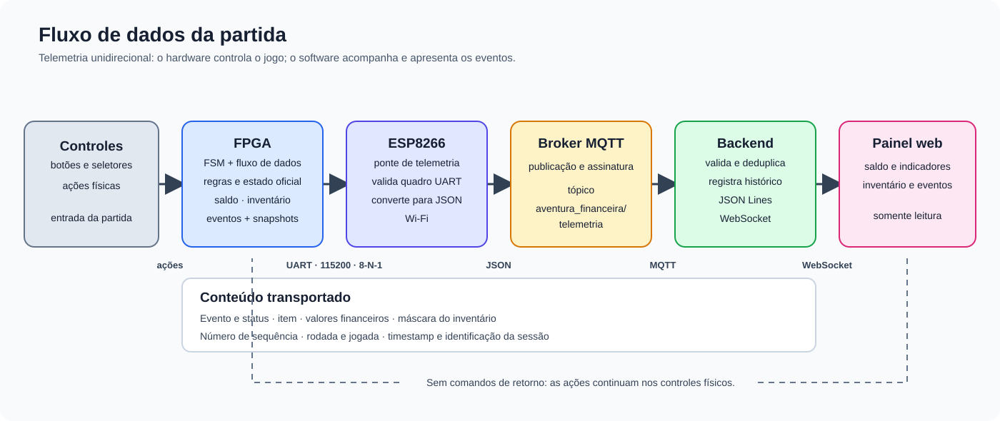
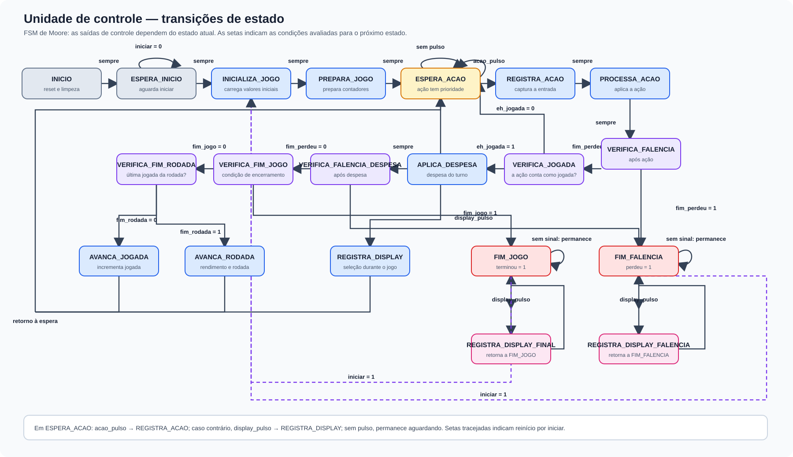

# projeto-labdig
Respositório do projeto de desenvolvimento de um circuito digital para auxiliar a educação financeira de crianças e adolescentes, em especial daquelas no espectro autista. O projeto consiste em um jogo de tabuleiro digital interativo que simula situações da vida real.

## Telemetria FPGA, ESP8266 e painel

A FPGA continua executando as regras do jogo. A saida UART envia snapshots para
o firmware ESP8266, que publica eventos MQTT; o backend valida e encaminha os
dados por WebSocket ao front-end.

- RTL UART e captura de eventos: `circuito/telemetria_uart.v` e
  `circuito/circuito_jogo_financeiro.v` (saida nova `uart_tx`).
- A FSM em `circuito/unidade_controle.v` continua sendo Moore, com estados
  separados e nomes que descrevem cada etapa do jogo.
- Testbenches Verilog para ModelSim ficam em
  [`fpga/testbench/README.md`](fpga/testbench/README.md); o teste de protocolo
  do firmware fica separado em [`esp8266/testbench/`](esp8266/testbench/).
- Os modulos FPGA continuam em `circuito/` para manter o projeto Quartus; a
  pasta `fpga/testbench/` guarda somente os testbenches FPGA e a pasta
  `esp8266/` guarda somente firmware e testes ESP8266.
- Firmware ESP8266 e ligacao UART: [`esp8266/README.md`](esp8266/README.md).
- Backend MQTT/WebSocket: [`backend/README.md`](backend/README.md).
- Contrato de dados e escala monetaria:
  [`CONTEXTO_TECNICO_AEF_FPGA_ESP32_FRONTEND.md`](CONTEXTO_TECNICO_AEF_FPGA_ESP32_FRONTEND.md).
- Painel e conexao WebSocket: [`frontend/README.md`](frontend/README.md).

## Projeto do fluxo de dados

Os controles físicos alimentam a FPGA, que executa as regras e mantém o estado oficial da partida. A cada ação ou evento relevante, o circuito captura um snapshot — por exemplo, saldo, salário, investimento, despesas, inventário, rodada e jogada — e o transmite como uma linha serial pela UART (115200 baud, 8-N-1). A ESP8266 valida esse quadro, converte os valores monetários para centavos e acrescenta os metadados da sessão antes de publicá-lo como JSON no tópico MQTT `aventura_financeira/telemetria`.

O backend assina o tópico, valida os eventos, descarta sequências duplicadas ou fora de ordem, registra o histórico em JSON Lines e distribui snapshots e atualizações pelo WebSocket. O painel apresenta esses dados em tempo real e é somente leitura: ações não retornam pela rede, pois continuam sendo feitas nos controles conectados à FPGA. Assim, a telemetria acompanha a partida sem transferir para o software as regras executadas no hardware.

## Projeto da unidade de controle

A unidade de controle é uma máquina de Moore, cujas saídas dependem do estado atual. Após o reset, aguarda o comando de início, inicializa a partida e passa a esperar ações. Cada ação é registrada e processada; quando consome uma jogada, a unidade aplica as despesas e verifica falência, fim de jogo e fim de rodada, avançando os contadores quando necessário. Na espera, uma ação tem prioridade sobre a seleção do display.

A seleção do display apenas atualiza o valor exibido e retorna à espera, sem avançar a partida. Se houver falência ou fim de jogo, a unidade entra no estado terminal correspondente, mantém a indicação do resultado e permite consultar o display; um novo comando de início reinicia a partida. O diagrama apresenta os estados e suas condições de transição.

**Hardware:** o `uart_tx` ainda nao esta associado a um pino no QSF. Confirme
um pino de expansao livre e o nivel eletrico antes de ligar a entrada RX da
ESP8266. A serial usa 115200 baud, 8-N-1; a entrada ESP8266 exige sinal compativel
com 3,3 V e pode exigir conversao de nivel.

## Diagramas de montagem física

- [Visão geral da montagem de bancada](images/montagem-fisica.svg): placa FPGA,
  controles, saídas, programação, ESP8266, instrumentos e alimentação.
- [Detalhe da ligação UART e depuração](images/ligacao-uart-bancada.svg):
  conexão TX/RX, sonda lógica, GND comum e fontes separadas.

Os diagramas são funcionais, não substituem o manual da placa nem a pinagem do
conector de expansão. O pino físico de `uart_tx` ainda precisa ser escolhido e
atribuído no QSF; confirme também a compatibilidade elétrica antes da montagem.
