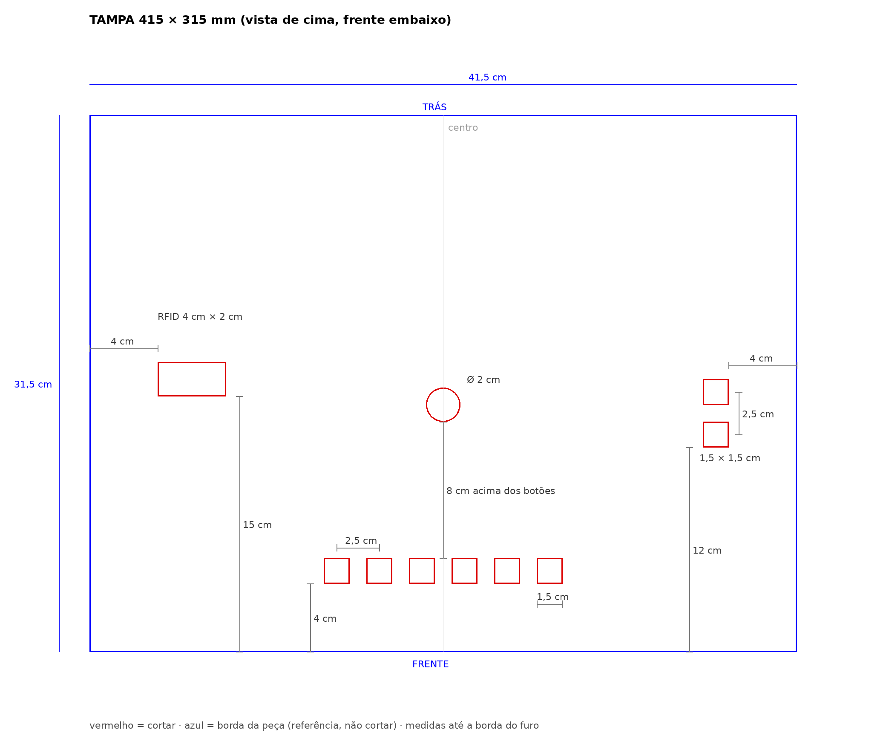
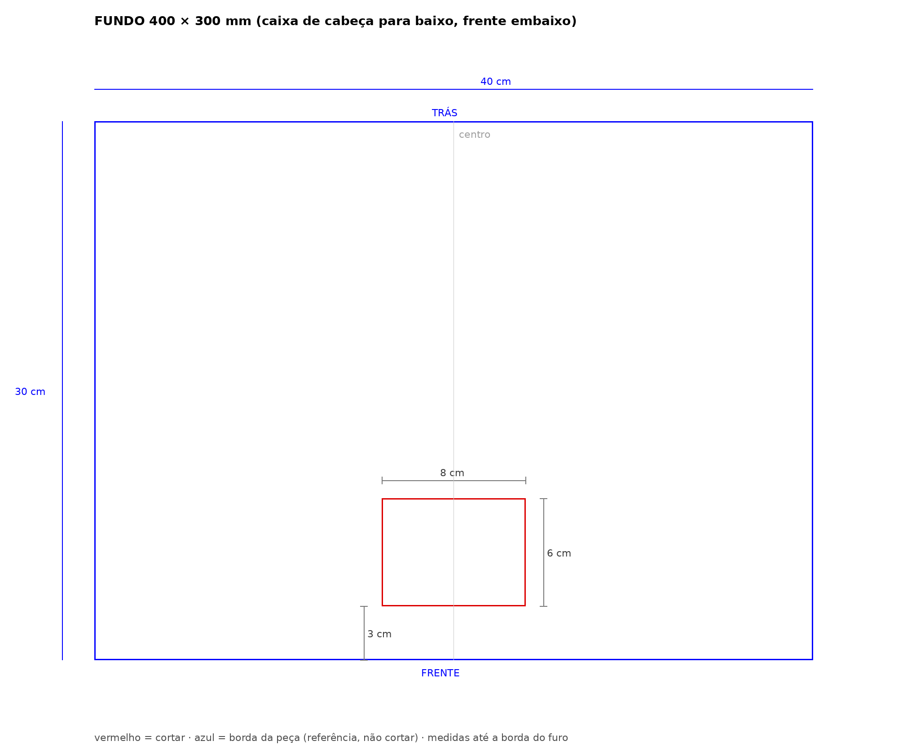

# Corte a laser: tampa e fundo da caixa

Para o passo a passo no laboratório, veja [PASSO_A_PASSO.md](PASSO_A_PASSO.md).

Arquivos para abrir os furos na caixa de MDF pronta (41,5 × 31,5 × 20,5 cm,
MDF cru de **5 mm**) na **Epilog Fusion Pro 48**. A laser não corta o contorno
das peças: ela só fura a tampa e o fundo da caixa já montada.

Medidas tiradas do desenho [`caixa-labdig.pdf`](caixa-labdig.pdf) e confirmadas
uma a uma. Todas vão da borda da peça até a **borda** do furo, menos o
espaçamento de 2,5 cm entre botões, que é **entre centros**.

| Peça | Arquivo | Conferência |
|---|---|---|
| Tampa (415 × 315 mm) | `tampa.pdf` · `tampa.svg` · `tampa.dxf` |  |
| Fundo (400 × 300 mm), caixa de cabeça para baixo | `fundo.pdf` · `fundo.svg` · `fundo.dxf` |  |
| Sobreposição no seu desenho | `sobreposicao_tampa.png` | furos gerados (verde) sobre o desenho a lápis |
| Peça de teste (75 × 40 mm) | `teste.pdf` · `teste.svg` · `teste.dxf` | 1 furo de botão + 1 do seletor |

## Furos

**Tampa** (vista de cima, frente da caixa embaixo no arquivo)

| Furo | Tamanho | Posição |
|---|---|---|
| 6 botões de ação | 1,5 × 1,5 cm | 2,5 cm entre centros, fileira centralizada, borda de baixo a 4 cm da frente |
| Seletor | Ø 2 cm (raio 1 cm) | centralizado, borda de baixo 8 cm acima da borda de cima dos botões (13,5 cm da frente) |
| 2 botões da direita | 1,5 × 1,5 cm | lado direito a 4 cm da borda direita; o de baixo a 12 cm da frente; o de cima 2,5 cm acima (entre centros) |
| RFID | 4 × 2 cm | lado esquerdo a 4 cm da borda esquerda, borda de baixo a 15 cm da frente |

**Fundo**: abertura de 8 × 6 cm, centralizada, com a borda a 3 cm da frente.

## Cores do arquivo

- **Vermelho RGB(255, 0, 0), linha fina (0,025 mm)**: cortar (vetor).
- **Azul RGB(0, 0, 255)**: borda da peça, só para conferência. **Não cortar**:
  desligue o azul no mapeamento de cores (*Color Mapping*) do driver ou apague
  a camada `referencia_nao_cortar` antes de enviar.
- No `.dxf`, as mesmas coisas estão nas camadas `CORTE` (vermelho) e
  `REFERENCIA_NAO_CORTAR` (azul). Unidade: mm.

O PDF já está em tamanho real (1:1). Imprima com escala 100%, sem "ajustar à
página".

## Na laser

1. **Teste primeiro.** Corte `teste.pdf` num retalho de MDF de 5 mm (o arquivo
   inteiro é vermelho, inclusive o contorno). Confira se o corte atravessa e se
   o botão e o seletor encaixam nos furos.
2. **Tampa:** coloque a tampa com a face de cima para cima e a **frente da
   caixa virada para você** (frente da máquina). Encoste o canto de trás à
   esquerda no canto de cima à esquerda da mesa (origem da régua). Foque na
   superfície da tampa.
3. **Fundo:** coloque a caixa **de cabeça para baixo**, também com a frente
   virada para você, e encoste o canto de trás à esquerda na origem. A caixa
   tem 20,5 cm de altura; abaixe a mesa e foque na superfície do fundo.
   Confira antes se a altura cabe na sua máquina. A abertura é centralizada,
   então virar a caixa não troca esquerda e direita.
4. Antes de cortar, use o laser vermelho (ou a câmera) para conferir se a
   borda azul da peça bate com a borda real.

**Configuração de corte (ponto de partida para MDF de 5 mm):** processo
*Vector*, ar assistido ligado, frequência por volta de 10–20%, potência 100%.
A velocidade depende da potência da sua máquina (60, 80 ou 120 W). Comece pela
tabela de materiais da Epilog ou do laboratório para MDF de 1/4" (6 mm) e ajuste
com a peça de teste. Se não atravessar, faça uma segunda passada em vez de
baixar muito a velocidade, para queimar menos a borda.

O feixe tira cerca de 0,1–0,2 mm de material, então os furos saem um pouco
maiores que o desenho. Isso dá folga para os botões e o seletor.

## Mudar uma medida

As medidas ficam no topo de [`gerar.py`](gerar.py). Mude o valor e rode:

```sh
python3 corte-laser/gerar.py
```

O script refaz todos os arquivos e as imagens de conferência. Ele também
avisa se algum furo ficar a menos de 8 mm da borda ou de outro furo.
