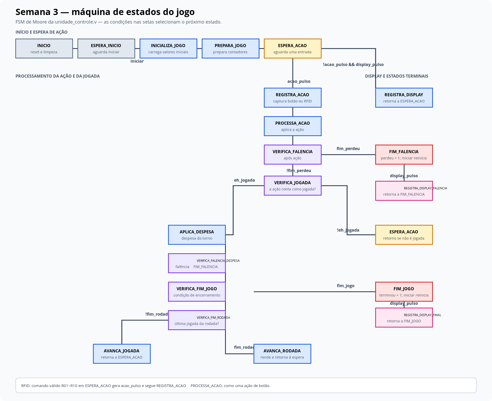
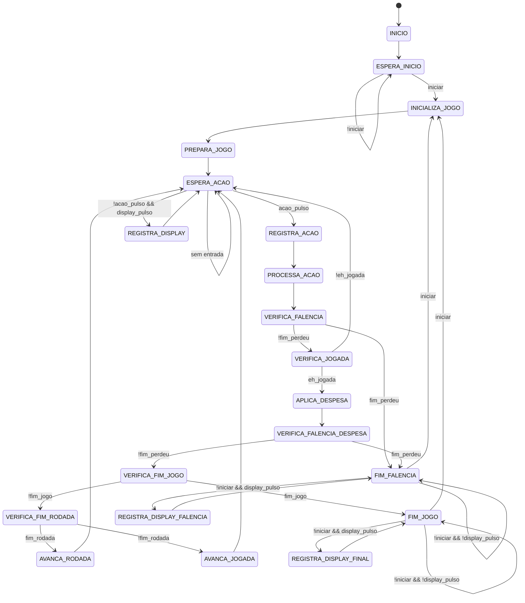
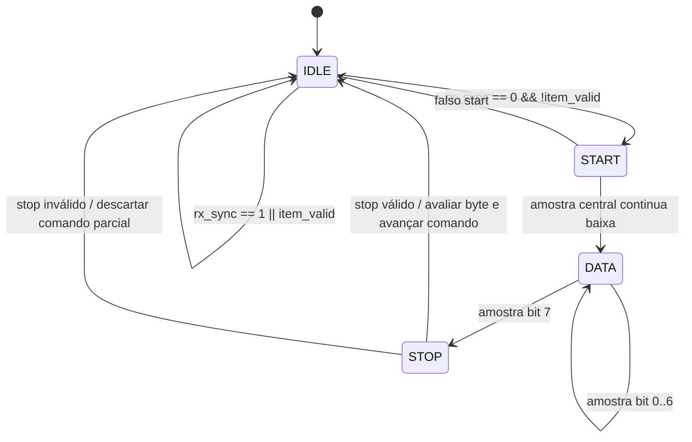

# Diagramas de estados — semana 3

Diagramas derivados da RTL presente em `fpga/rtl/`. O primeiro descreve a FSM
de jogo em `unidade_controle.v`; o segundo, a recepção UART de
`rfid_uart_rx.v`.

## Unidade de controle do jogo

Em `ESPERA_ACAO`, `acao_pulso` tem prioridade sobre `display_pulso`, conforme a
ordem das condições na RTL.

## Receptor UART RFID

O receptor amostra UART 8-N-1 e monta os bytes em ordem LSB-first. A validação
dos bytes compõe o comando `RNN\n`; somente itens de `01` a `10` elevam
`item_valid`. O acknowledge limpa `item_valid` de forma sincronizada; enquanto
o comando continua pendente, novos starts são ignorados.

