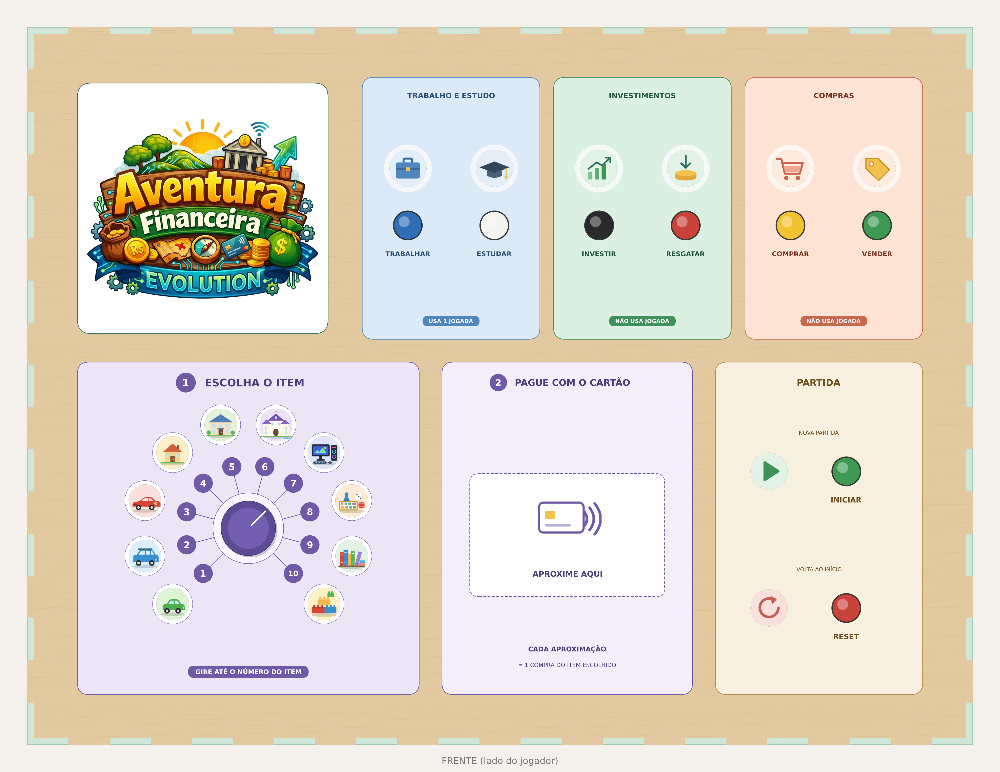
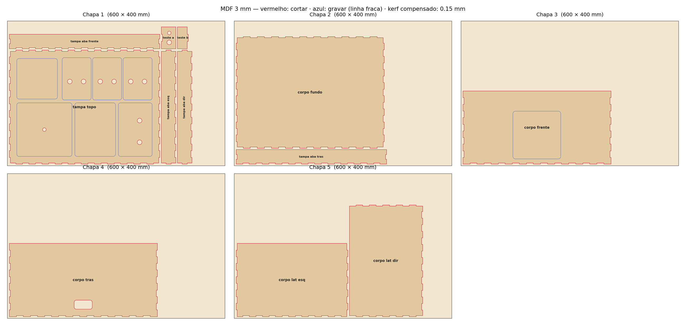

# Modelagem da caixa

Caixa do jogo em **MDF de 3 mm cortado a laser**, com encaixes de dedo
(finger joints): um corpo aberto em cima e uma tampa que encaixa por fora,
como uma caixa de sapato. Medidas externas com a tampa fechada:
**415 × 315 × 205 mm**.



Na tampa ficam **só os controles do jogador**: os 6 botões de ação, INICIAR,
RESET, o seletor de item e a área do cartão. Tudo o que o painel web já mostra
**não vai na caixa**:

| Saiu da caixa | Sinal da FPGA | Onde aparece agora |
|---|---|---|
| 10 LEDs "meus itens" | `indicador_itens[9:0]` | inventário no painel web |
| displays RODADA e JOGADA | `display_rodadas`, `display_jogadas` | rodada e jogada no painel |
| LEDs ÚLTIMA RODADA/JOGADA | `ultima_rodada`, `ultima_jogada` | rodada e jogada no painel |
| LEDs FIM DO JOGO e FALIU | `terminou`, `perdeu` | tela de fim de jogo no painel |
| 6 botões de consulta | `config_display[5:0]` | saldo, salário, investido, rendimento e gastos no painel |

Os sinais continuam no projeto da FPGA, mas ficam sem ligação.

Tudo é gerado por [`caixa.py`](caixa.py). As medidas ficam no topo do arquivo:
mude o valor e rode de novo para atualizar todos os arquivos. O script confere
sozinho:

- as margens e a distância entre os furos;
- se cada furo cai dentro do seu adesivo;
- se as peças de MDF encaixam sem se sobrepor;
- se cada peça cabe na chapa.

```sh
modelagem/.venv/bin/python modelagem/caixa.py
```

## Ilustrações do jogo na caixa

- **Logotipo** (`front/images/logo.jpe`, o mesmo do painel web): um adesivo de
  110 mm na tampa (canto de trás, à esquerda) e um de 130 mm na frente do corpo.
- **Os 10 itens da loja** (`front/images/itens/`): em volta do seletor, cada um
  ao lado do seu número. O jogador gira até a ilustração do item que quer.
- **Ícones das ações** (`arte/svg/`): acima de cada botão.

## O que fica em cada parte da tampa

| Adesivo | Cor de fundo | O que tem |
|---|---|---|
| **1 Escolha o item** | lilás `#ECE5F6` | seletor rotativo; números 1–10 e a ilustração de cada item |
| **2 Pague com o cartão** | lilás claro `#F3EEFA` | área "aproxime aqui" (RC522 por baixo, sem furo) |
| **Partida** | creme `#F7EFDF` | INICIAR (capa verde) e RESET (capa vermelha) |
| **Logotipo** | branco | logo do Aventura Financeira Evolution |
| **Trabalho e estudo** | azul pastel `#DCEAF7` | TRABALHAR (azul), ESTUDAR (branca); "USA 1 JOGADA" |
| **Investimentos** | verde pastel `#DCF0E2` | INVESTIR (preta), RESGATAR (vermelha); "NÃO USA JOGADA" |
| **Compras** | pêssego `#FCE3D3` | COMPRAR (verde), VENDER (amarela); "NÃO USA JOGADA" |

As cores das capas são as da pinagem da Semana 3, então não é preciso refazer
a fiação. Os fundos pastel atendem ao requisito CONFORTO_SENSORIAL, e o ícone com
nome escrito em cada botão atende a USABILIDADE_LITERAL.

## Arquivos para o corte a laser (`saida/laser/`)

| Arquivo | Uso |
|---|---|
| `chapa_1.dxf` … `chapa_5.dxf` | **Mandar para o laser.** Um arquivo por chapa de 600 × 400 mm, em mm. Abre no AutoCAD, LibreCAD, LightBurn e RDWorks. |
| `chapa_1.svg` … `chapa_5.svg` | Os mesmos desenhos em SVG (Inkscape, LightBurn), 1 unidade = 1 mm. |
| `todas_as_chapas.dxf` | Todas as chapas lado a lado, com o nome das peças. **Só para conferir**, não cortar. |
| `mapa_chapas.png` | Mapa de qual peça está em cada chapa. |
| `pecas.csv` | Lista das 12 peças (10 da caixa e 2 de teste) com medidas e chapa. |

As cores e camadas dos arquivos de corte:

| Camada | Cor | Operação no laser |
|---|---|---|
| `CORTE` | vermelho | cortar (atravessa a chapa): contornos, furos dos botões e do seletor, rasgo dos cabos |
| `GRAVACAO` | azul | **linha fraca** (pouca potência, só marca): onde colar cada adesivo |

Os contornos já estão com o **kerf compensado** (`KERF = 0,15 mm`): as peças
saem com a medida certa e os encaixes ficam justos. Dentro de cada arquivo a
ordem é: primeiro as gravações, depois os furos e por último os contornos. Assim
a peça só se solta da chapa no fim.



| Peça | Medida (mm) | Detalhe |
|---|---|---|
| Tampa: topo | 415 × 315 | 8 furos Ø13 (botões), 1 furo Ø10 (seletor), contornos gravados dos 7 adesivos |
| Tampa: abas frente/trás | 415 × 40 | — |
| Tampa: abas laterais | 315 × 40 | — |
| Corpo: fundo | 408 × 308 | — |
| Corpo: frente | 408 × 202 | contorno gravado do logotipo |
| Corpo: traseira | 408 × 202 | rasgo de 50 × 25 mm para os cabos USB |
| Corpo: laterais | 308 × 202 | — |
| Teste A / Teste B | 60 × 40 / 60 × 30 | encaixe de dedo + furos Ø13 e Ø10 para testar |

## Outros arquivos gerados (`saida/`)

| Arquivo | Uso |
|---|---|
| `previa_colorida.png` | Como a tampa fica pronta. Referência para a montagem. |
| `previa_tampa.png` | Desenho técnico do topo da tampa: furos com coordenadas e contornos gravados. |
| `arte_adesivos.pdf` | **3 folhas A4** com os adesivos em tamanho real (7 da tampa + logo da frente). |
| `lista_componentes.csv` | Cada componente: posição (mm), furo, cor, sinal, pino da DE0-CV e conector. Também lista o que **não** vai na caixa. |
| `caixa.step` | Modelo 3D montado. Abre no Fusion 360 (*File → Open*). Cada peça de MDF é o mesmo contorno do arquivo de corte. |
| `caixa.stl` | Modelo 3D para visualização rápida. |
| `caixa.glb`, `textura_*.png`, `visualizador.json` | Modelo com cores e arte, usado pelo visualizador web. |

## Passo a passo (Semana 4)

Faça na ordem. Cada etapa termina com uma conferência; não avance se ela falhar.

### 1. Conferir medidas e materiais

- [ ] Medir com paquímetro a **espessura real do MDF** (`MDF`). Chapa vendida
      como "3 mm" costuma ter entre 2,7 e 3,2 mm.
- [ ] Perguntar no laboratório o **tamanho da área de corte** da máquina
      (`CHAPA_C`, `CHAPA_L`). Com 600 × 400 mm são 5 chapas; com 900 × 600 mm,
      menos.
- [ ] Medir a capa dos botões (`CAPA_DIAM`) e a rosca do seletor
      (`FURO_SELETOR`).
- [ ] Se algo diferir, corrigir em `caixa.py` e rodar o script de novo.
- [ ] Separar o material:
  - 8 botões 12×12 com capas (2 verdes, 2 vermelhas, 1 azul, 1 branca, 1 preta, 1 amarela);
  - 1 chave rotativa de 10+ posições com knob;
  - placas: RC522, ESP32 e placas perfuradas;
  - espaçadores de 8 mm e 10 mm e jumpers longos (50 cm);
  - acabamento: cola branca (PVA) para madeira, fita dupla-face, tinta verde-menta, verniz fosco e papel couchê.

### 2. Cortar a laser

- [ ] Abrir `saida/laser/chapa_1.dxf` (ou o `.svg`) no software da máquina.
      Conferir a escala: o topo da tampa deve medir 415 × 315 mm.
- [ ] Configurar: camada **vermelha = corte**, camada **azul = linha** com
      potência baixa (só marcar).
- [ ] **Cortar primeiro só as peças de teste** (Teste A e Teste B, na chapa 1).
      Encaixar uma na outra:
  - **justo, entra com pressão leve:** ok;
  - **folgado:** aumentar `KERF` (por exemplo para 0,2) e gerar de novo;
  - **não entra:** diminuir `KERF`.

  Conferir também se a capa do botão passa no furo de 13 mm e se a rosca do
  seletor passa no de 10 mm.
- [ ] Cortar as 5 chapas. Separar as peças conforme `mapa_chapas.png`.

### 3. Montar a caixa

- [ ] Montar o corpo a seco (sem cola): fundo + frente + traseira + laterais.
      Os dedos devem fechar as quinas sem frestas.
- [ ] Colar com cola branca nas juntas, apertar com fita crepe ou grampos e
      conferir o esquadro. Esperar secar.
- [ ] Montar a tampa do mesmo jeito: topo + 4 abas. A tampa tem que entrar no
      corpo com folga leve (0,5 mm de cada lado).
- [ ] Lixar de leve as bordas queimadas (lixa 220).

### 4. Pintar, envernizar e colar os adesivos

- [ ] Pintar **só as abas da tampa** de verde-menta `#CFE7D9`, em duas demãos finas.
- [ ] Passar verniz fosco à base d'água no resto. Esperar secar.
- [ ] Imprimir `arte_adesivos.pdf` a **100%** em couchê fosco. A régua de cada
      folha deve medir 100 mm. Recortar na linha tracejada.
- [ ] Colar cada adesivo **dentro do contorno gravado** pelo laser. Os círculos
      impressos devem coincidir com os furos. Usar cola em bastão ou dupla-face
      fina e alisar do centro para as bordas.
- [ ] Com estilete, recortar o papel sobre cada furo, por cima.
- [ ] Colar o logotipo grande dentro do contorno gravado na frente do corpo.

### 5. Montar os componentes sob a tampa

- [ ] **Botões de ação:** soldar os 6 numa placa perfurada comprida (centros em
      x = 167, 205, 251, 289, 335 e 373 mm; conferir por `previa_tampa.png`).
      Fixar sob a tampa com espaçadores de **8 mm** (valor calculado pelo
      script), para a capa sair 2 mm acima da tampa.
- [ ] **INICIAR/RESET:** numa segunda placa, na vertical (60 mm entre os dois),
      com espaçadores de 8 mm.
- [ ] **Seletor:**
  - passar a chave pelo furo de 10 mm, apertar a porca por cima e colocar o knob;
  - girar até o batente e conferir que a seta aponta para o **1** (carro
    compacto); se não apontar, soltar o knob e reposicionar;
  - ligar o comum da chave ao **GND**: `seletor_item` é ativo em nível baixo.
- [ ] **RC522:** colar por baixo, centrado em "APROXIME AQUI", com a antena para
      cima.
- [ ] **ESP32:** fixar sob a tampa, logo atrás do RC522 (posição em
      `lista_componentes.csv`), com os fios SPI de no máximo 15 cm.

### 6. Interior e fios

- [ ] Fixar a DE0-CV no fundo, perto da traseira, com espaçadores de 10 mm.
- [ ] Ligar cada fio conforme `lista_componentes.csv`, **com as placas
      desligadas**. GND comum entre FPGA e ESP32; não unir os VCC.
- [ ] Juntar num feixe com espiral os fios que sobem para a tampa, com 40–50 cm
      de folga, para tirar a tampa e apoiar ao lado sem puxar nada.
- [ ] Passar os cabos USB (FPGA e ESP32) pelo rasgo da traseira.

### 7. Testar com a caixa fechada

- [ ] Cada botão gera a ação certa no painel web.
- [ ] O seletor mostra o item certo no painel nas posições 1 a 10.
- [ ] O cartão é lido através da tampa a até 5 cm (DETECCAO_PAGAMENTO), e o
      painel atualiza em até 1 s (FEEDBACK_IMEDIATO).

## Medidas a conferir

| Parâmetro em `caixa.py` | Valor usado | Situação |
|---|---|---|
| `CAIXA_C/L/A` | 415 × 315 × 205 mm | medidas externas, mantidas do modelo anterior |
| `MDF` | 3 mm | **assumido**: medir a chapa |
| `KERF` | 0,15 mm | **assumido**: ajustar pela peça de teste |
| `CHAPA_C/L` | 600 × 400 mm | **assumido**: área útil da cortadora |
| `TAMPA_A` | 40 mm | altura da tampa |
| `CAPA_DIAM`, `FURO_BOTAO` | 12 mm / 13 mm | **assumido**: medir a capa do kit |
| `ALTURA_BOTAO_CAPA` | 13 mm | **assumido**: da placa até o topo da capa |
| `FURO_SELETOR` | 10 mm | **assumido**: bucha de 3/8" da chave rotativa |
| `RC522_C/L` | 60 × 40 mm | típico: conferir a placa |
| `FPGA_C/L` | 128 × 99 mm | DE0-CV segundo fonte de terceiros: conferir |

## Visualizar o modelo 3D

### No navegador

1. No terminal do WSL, na raiz do repositório:

   ```sh
   sh modelagem/visualizar.sh
   ```

   O script cria o ambiente Python na primeira vez, gera o modelo e sobe um
   servidor na porta 8000. Para outra porta: `PORTA=8080 sh modelagem/visualizar.sh`.
2. No navegador do Windows, abra **http://localhost:8000/visualizador/**.
3. Controles:
   - arrastar: girar; roda: zoom; botão direito: mover;
   - **Peças:** liga e desliga cada grupo;
   - **Abrir tampa:** levanta a tampa;
   - **Transparentes:** deixa a caixa translúcida;
   - **Vistas:** 3D, cima, frente e trás.
   - Pela URL: `?vista=cima`, `?abrir=160` e `?painel=0` (sem o painel lateral).

A página carrega o three.js da internet (jsDelivr).

### Imagens do relatório

`docs/images/caixa-3d-fechada.png`, `caixa-3d-aberta.png` e `caixa-3d-cima.png`
saem do visualizador, capturadas por um Chrome sem janela:

```sh
modelagem/.venv/bin/python modelagem/capturar.py
```

O diagrama `docs/images/ligacoes-caixa.png` sai de
`docs/images/ligacoes-caixa.py`.

### No Fusion 360

*File → Open → Open from my computer* e escolha `modelagem/saida/caixa.step`
(no Windows: `C:\Users\Sophia\documents\projeto-labdig\modelagem\saida\caixa.step`).
O modelo abre como montagem, com o corpo e a tampa como submontagens.

## Ícones

Os ícones dos adesivos estão em `arte/png/`. Os das ações e do cartão são
desenhados em `arte/svg/`, e os dos 10 itens são os do painel web
(`front/images/itens/`). Se mudar um SVG, gere os PNG de novo (precisa do
Chrome ou Chromium):

```sh
modelagem/.venv/bin/python modelagem/arte/gerar_icones.py
```

## Ambiente

Requer Python 3.10+. Na raiz do repositório (WSL/Linux):

```sh
python3 -m venv modelagem/.venv
modelagem/.venv/bin/pip install -r modelagem/requirements.txt
```
