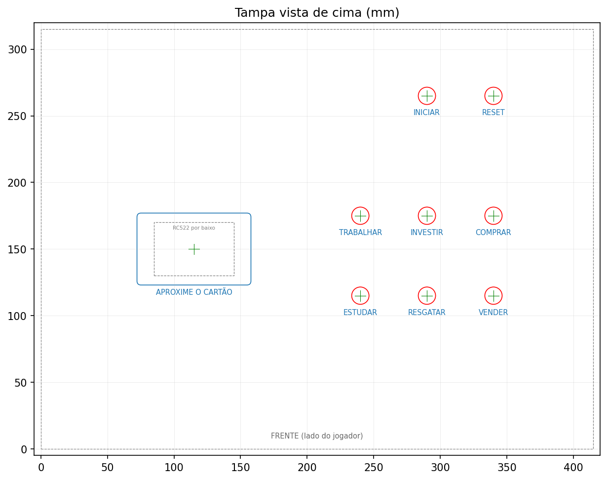

# Modelagem da caixa

Gabaritos de furação e modelo 3D da caixa MDF cru **41,5 × 31,5 × 20,5 cm**
que abriga o jogo. Só o leitor RFID (RC522) e os botões ficam acessíveis; a
DE0-CV e a ESP32 ficam escondidas dentro.

Tudo é gerado por [`caixa.py`](caixa.py). As medidas ficam no topo do arquivo:
mude o valor e rode de novo para atualizar todos os arquivos.

```sh
modelagem/.venv/bin/python modelagem/caixa.py
```

## Arquivos gerados (`saida/`)

| Arquivo | Uso |
|---|---|
| `gabarito_tampa.pdf` | Imprimir em **tamanho real (100%)**, 4 folhas A4. Emendar com 10 mm de sobreposição, colar na tampa e furar nas cruzes. A régua de cada folha deve medir 100 mm. |
| `gabarito_traseira.pdf` | Mesmo processo para o rasgo de cabos na parede traseira (2 folhas A4). |
| `gabarito_tampa.dxf`, `gabarito_traseira.dxf` | Os mesmos desenhos para AutoCAD, LibreCAD, LightBurn ou CNC, em mm. |
| `caixa.step` | Modelo 3D montado: caixa, tampa, botões, RC522, DE0-CV e ESP32. Abre no Fusion 360 (*File → Open*). |
| `caixa.stl` | Modelo 3D para visualização rápida. |
| `caixa.glb` | Modelo 3D com cores, usado pelo visualizador web. |
| `previa_tampa.png` | Prévia da tampa. |

Camadas dos DXF: `CORTE` (vermelho, furar/cortar), `CENTRO` (verde, cruz para a
broca), `GRAVACAO` (azul, textos e área do cartão para gravar ou pintar) e
`REFERENCIA` (cinza tracejado, contorno e peças por baixo; não cortar).

## Visualizar o modelo 3D

### No navegador (mais rápido)

1. No terminal do WSL, na raiz do repositório:

   ```sh
   sh modelagem/visualizar.sh
   ```

   O script cria o ambiente Python na primeira vez, gera o modelo e sobe um
   servidor na porta 8000. Se a porta já estiver ocupada, por exemplo por um
   visualizador anterior, ele encerra esse processo antes. Para usar outra
   porta: `PORTA=8080 sh modelagem/visualizar.sh`.
2. No navegador do Windows, abra **http://localhost:8000/visualizador/**.
3. Controles:
   - arrastar: girar; roda do mouse: zoom; botão direito: mover;
   - **Peças**: liga e desliga caixa, tampa, botões, RC522, DE0-CV e ESP32;
   - **Abrir tampa**: levanta a tampa para ver o interior;
   - **Transparentes**: deixa caixa e tampa translúcidas;
   - **Vistas**: 3D, cima, frente (lado do jogador) e trás (rasgo dos cabos).
4. Depois de mudar uma medida em `caixa.py`, pare com `Ctrl+C` e rode o
   script de novo. Recarregue a página com `Ctrl+F5`.

A página carrega a biblioteca three.js da internet (jsDelivr), então o
computador precisa estar conectado.

### No Fusion 360

1. *File → Open → Open from my computer* e escolha
   `modelagem/saida/caixa.step`. No Windows, o caminho é
   `C:\Users\Sophia\documents\projeto-labdig\modelagem\saida\caixa.step`.
2. O modelo abre como montagem, com uma peça por componente. Use o ícone de
   olho no navegador lateral para esconder a tampa.
3. Para ver o gabarito sobre a tampa: *Insert → Insert DXF* com
   `saida/gabarito_tampa.dxf`, no plano do topo.

## Layout da tampa



- **RFID à esquerda:** o RC522 fica colado por baixo da tampa, centrado na área
  "APROXIME O CARTÃO". Não há furo: o leitor lê através do MDF.
- **Ações em grade 3 × 2**, em pares por coluna: trabalhar/estudar,
  investir/resgatar, comprar/vender. Passo de 50 mm.
- **Iniciar e reset** separados no fundo, a 90 mm das ações, para não serem
  apertados sem querer.
- Origem no canto frontal esquerdo (lado do jogador). X ao longo dos 415 mm,
  Y ao longo dos 315 mm.

## Montagem

1. Fure a tampa com broca de **13 mm**: chata ou serra-copo, de cima para baixo,
   com um pedaço de madeira embaixo para não lascar.
2. Solde os botões 12×12 em placa perfurada e fixe a placa sob a tampa com
   espaçadores de **5 mm** (valor calculado pelo script). Assim a capa sai
   2 mm acima da tampa.
3. Cole o RC522 sob a área do cartão, com fita dupla-face ou cola quente, com
   a antena voltada para cima.
4. Fixe a DE0-CV e a ESP32 no fundo com espaçadores de 10 mm, perto da
   parede traseira, e passe os cabos USB pelo rasgo de 50 × 25 mm.

## Medidas a conferir

| Parâmetro em `caixa.py` | Valor usado | Situação |
|---|---|---|
| `CAIXA_C/L/A` | 415 × 315 × 205 mm | confirmado (anúncio) |
| `MDF` | 6 mm | **assumido**: medir a espessura da tampa |
| `TAMPA_A` | 50 mm | **assumido**: só afeta o 3D e a altura da traseira |
| `CAPA_DIAM`, `FURO_BOTAO` | 12 mm / 13 mm | **assumido**: medir a capa do kit |
| `ALTURA_BOTAO_CAPA` | 13 mm | **assumido**: da placa até o topo da capa |
| `RC522_C/L` | 60 × 40 mm | típico: conferir a placa |
| `FPGA_C/L` | 128 × 99 mm | DE0-CV segundo fonte de terceiros: conferir |

Se a tampa tiver mais de 6 mm, o RC522 pode perder alcance. Nesse caso, faça
um rebaixo por baixo na área do leitor, deixando cerca de 3 mm de madeira.

## Ambiente

Requer Python 3.10+. Na raiz do repositório (WSL/Linux):

```sh
python3 -m venv modelagem/.venv
modelagem/.venv/bin/pip install -r modelagem/requirements.txt
```

O Fusion 360 é um aplicativo do Windows. Ele não roda no WSL, mas abre os
arquivos `.step` e `.dxf` gerados aqui.
